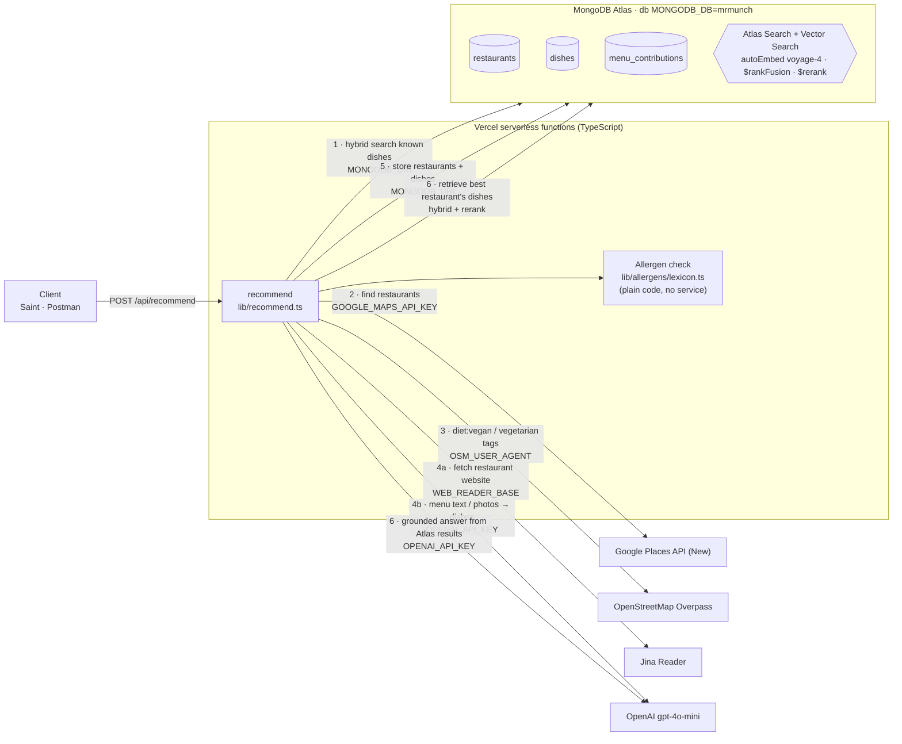

<p align="center"></p>

# Mr Munch API

Serverless backend for **Mr Munch**, an AI dining concierge for people with dietary restrictions (vegan, coeliac, shellfish allergy, …). Give it a location, a cuisine and the party's allergens and diets; it finds a nearby restaurant, reads its menu, checks every dish against the UK's 14 major allergens, and returns a hand-off for a Saint agent to book (always asking the user first).

- **Live:** https://mrmunch.vercel.app (root shows `/api/health`)
- **Design doc:** [`docs/DESIGN.md`](./docs/DESIGN.md), with the full architecture, request sequence, data model and feature status

## How it works

Each box is an external service; the label on the arrow is the `.env` variable that switches it on.



One `/api/recommend` call:

1. **MongoDB Atlas**: hybrid search (`$rankFusion` of full-text + vector search) over dishes already known nearby, excluding the party's allergens.
2. **Google Places**: up to 12 restaurants near the location (text search, falling back to nearby search).
3. **OpenStreetMap**: places tagged `diet:vegan` / `diet:vegetarian`, matched to Google's results by name and distance (≤ ~120 m). For vegan/vegetarian parties these venues are also saved to Atlas.
4. **For the top 4 candidates**: Google gives the website and photos, Jina Reader fetches the website as text, OpenAI extracts dishes (and reads photos when the website gives fewer than 3).
5. **Allergen check** on every dish (keyword matching over the 14 UK allergens), then restaurants and dishes are upserted into Atlas for the next user.
6. **RAG:** Atlas retrieves the best restaurant's dishes (hybrid search + Voyage rerank) and the LLM writes the recommendation from those dishes only: a summary, dishes to try and questions for the kitchen. Any dish name the model invents is dropped. If this run's dishes aren't embedded yet, it falls back to the freshly scraped menu and says so in `groundedAnswer.retrieval.source`. Skipped if the request has already used 45 s.
7. Returns the best restaurant, a suggested menu, a price estimate, alternatives, the `groundedAnswer` and a `nextSteps` hand-off with `requiresUserConfirmation: true`.

A fresh area takes **~45 s** (live websites are read). The response's `meta.sources` lists every step that ran.

## Endpoints

| Method | Path | Description |
|--------|------|-------------|
| `GET` | `/api/health` | Status, mode (`mock`/`live`) and which integrations are configured |
| `GET` | `/api/atlas/ping` | Checks the Vercel → Atlas connection and returns the dish count |
| `POST` | `/api/atlas/bootstrap` | Creates the regular, Atlas Search and Vector Search indexes (optional `x-bootstrap-secret` header) |
| `POST` | `/api/recommend` | Recommend a restaurant + checked menu + price |
| `POST` | `/api/menus/contribute` | Menu / specials-board photo → dishes in Atlas (OpenAI vision) |
| `GET` | `/api/menus/:restaurantId` | Stored menu for a restaurant |
| `POST` | `/api/directory/sync-vegan` | Seed OpenStreetMap vegan/vegetarian venues around a point into Atlas |

### Recommend request (`POST /api/recommend`)

```json
{
  "latitude": 51.5246,
  "longitude": -0.0784,
  "foodType": "vegan",
  "partySize": 2,
  "allergens": ["crustaceans", "molluscs"],
  "preferences": ["vegan", "gluten_free"],
  "dateTime": "2026-10-24T20:00:00+01:00",
  "radiusMeters": 1500
}
```

| Field | Type | Notes |
|-------|------|--------|
| `latitude` / `longitude` | number | WGS84 |
| `foodType` | string | Cuisine / style |
| `partySize` | int 1–40 | Number of diners |
| `allergens` | string[] | UK's 14: `celery`, `cereals_containing_gluten`, `crustaceans`, `eggs`, `fish`, `lupin`, `milk`, `molluscs`, `mustard`, `nuts`, `peanuts`, `sesame`, `soya`, `sulphur_dioxide` |
| `preferences` | string[] | `vegan`, `vegetarian`, `pescatarian`, `halal`, `kosher`, `coeliac`, `dairy_free`, `gluten_free`, `nut_free`, `shellfish_free` |
| `dateTime` | string | ISO 8601 **with timezone** |
| `radiusMeters` | int | Optional, default `2000` |

### Response (shape)

- `restaurant`: name, location, phone, website, photos, OpenStreetMap `diet` flags, `allergenConfidence` (`confirmed` · `menu_inferred` · `needs_restaurant_check`)
- `suggestedMenu`: up to 8 dishes with allergens and notes ("confirm with restaurant")
- `priceEstimate`: per person + total, GBP
- `alternatives`: up to 3 other restaurants
- `groundedAnswer`: `summary`, `dishesToTry` (names only from Atlas), `askTheKitchen`, and `retrieval` (`atlas_hybrid_search` or `fresh_menu_scrape`, the search method, dishes used)
- `nextSteps`: Saint hand-off, always `requiresUserConfirmation: true`
- `menuAnalysis`, `meta.sources`: what was parsed and which steps ran

## Environment variables

`vercel env pull` writes these into `.env` (never commit it). See `.env.example`.

| Variable | Used by | What it does | If missing |
|---|---|---|---|
| `GOOGLE_MAPS_API_KEY` | `lib/services/googleMaps.ts` | Finds restaurants, details, photos. **Its presence switches the app to live mode** | Mock restaurants only |
| `MONGODB_URI` | `lib/services/mongodb.ts` | Atlas connection string (database user + password, not an Atlas Admin API key) | No hybrid search, nothing stored; menu endpoints return 503 |
| `MONGODB_DB` | `lib/services/mongodb.ts` | Database name | Defaults to `mrmunch` |
| `OPENAI_API_KEY` | `lib/services/openaiVision.ts` | Turns menu web pages and photos into dishes | Crude regex menu parsing; no photo reading; `/api/menus/contribute` returns 503 |
| `OPENAI_VISION_MODEL` | `lib/services/openaiVision.ts` | Model for menu extraction | `gpt-4o-mini` |
| `OPENAI_ANSWER_MODEL` | `lib/services/groundedAnswer.ts` | Model for the grounded answer | Same as `OPENAI_VISION_MODEL` |
| `OSM_USER_AGENT` | `lib/services/openStreetMap.ts` | Identifies the app to Overpass (keep it plain; fancy UAs get HTTP 406) | `MrMunch/0.1` |
| `WEB_READER_BASE` | `lib/services/webReader.ts` | Website-to-text reader | `https://r.jina.ai/` |
| `ATLAS_VOYAGE_RERANK` | `lib/db/hybridSearch.ts` | Voyage `$rerank` (`rerank-2.5`) after `$rankFusion`; set `false` to turn it off | Rerank **on** (falls back silently if the cluster doesn't support it) |
| `BOOTSTRAP_SECRET` | `api/atlas/bootstrap.ts` | Required `x-bootstrap-secret` header for bootstrap | **Bootstrap is open to anyone**; set it before the repo is public |
| `MRMUNCH_MODE` | `lib/recommend.ts` | `mock` / `live` | Ignored when the Google key is set |
| `VOYAGE_API_KEY` | — | Not needed: embeddings and rerank run inside Atlas | — |
| `VERCEL_OIDC_TOKEN` | Vercel CLI only | Short-lived (12 h) project token written by `vercel env pull` | Not used by the app |

## MongoDB Atlas

**Features used**

| Feature | Status |
|---|---|
| Atlas Search (full-text on `dishes` and `restaurants`) | ✅ |
| Vector Search on `dishes.searchText` | ✅ |
| Automated Embedding (`autoEmbed`, Voyage `voyage-4`) | ✅ |
| Hybrid Search (`$rankFusion`, vector 0.55 + text 0.45) | ✅ running live |
| Voyage AI rerank (`$rerank`, `rerank-2.5`) | ✅ on by default; check `meta.sources` shows `hybrid_rankFusion_voyage_rerank` |
| RAG: grounded answer from Atlas-retrieved dishes | ✅ `groundedAnswer` in the response |
| Stream Processing (`atlas/stream-processing/`) | 🟡 pipeline defined, not deployed |

Index definitions live in `atlas/indexes/*.json`.

**Setup**

1. [cloud.mongodb.com](https://cloud.mongodb.com) → create project `mrmunch` → create a cluster (M0 to start; M10+ if Automated Embedding requires it).
2. **Database Access** → add a database user with a password.
3. **Network Access** → allow `0.0.0.0/0` (Vercel has no fixed IPs).
4. **Connect → Drivers** → copy the `mongodb+srv://…` URI.
5. `vercel env add MONGODB_URI` and `MONGODB_DB=mrmunch`, then redeploy.
6. `POST /api/atlas/bootstrap` once, then wait until the search indexes are **Ready** in Atlas.

**Data and privacy:** Atlas only stores knowledge about places (restaurants, dishes, menu photos). **No personal data**: nobody's allergies are stored. Each user's Saint keeps their restrictions and sends them with each request.

## Testing

**Against the live deployment**

```bash
BASE=https://mrmunch.vercel.app
curl $BASE/api/health
curl $BASE/api/atlas/ping
curl -X POST $BASE/api/recommend -H 'Content-Type: application/json' -d '{
  "latitude": 51.5246, "longitude": -0.0784, "foodType": "vegan", "partySize": 2,
  "allergens": ["crustaceans","molluscs"], "preferences": ["vegan","gluten_free"],
  "dateTime": "2026-10-24T20:00:00+01:00", "radiusMeters": 1500 }'
```

Each live call spends Google and OpenAI credit and writes to the shared Atlas database. Or import [`postman/MrMunch.postman_collection.json`](./postman/MrMunch.postman_collection.json) and set `baseUrl`.

**Locally**

```bash
npm install
npm run typecheck
cp .env.example .env   # empty keys = mock mode; or `vercel env pull` for the real ones
npm run dev            # vercel dev → http://localhost:3000 (run `vercel login` once)
```

## Known limitations

- **Latency:** ~45 s for a fresh area; menus already in Atlas are re-scraped rather than reused.
- **Allergen check is keyword-based:** it errs on "unknown", which is reported as needing kitchen confirmation, never as safe.
- **Google data in Atlas:** restaurant name, address, phone, rating and photo URLs from Google are stored; Google's terms only allow storing `place_id`, and photo URLs expire.
- **OSM listings** are saved as dish-like documents with `source: "restaurant_confirmed"`, which overstates them.
- **Overpass** blocks many cloud IPs with 406; the code tries the French mirror first and falls back to OSM venues already in Atlas.
- **No auth** on any endpoint.
- **Deploys come from local files** (`npm run deploy`), not from GitHub, so the live deployment can be ahead of this repo.

## Deploy

```bash
npm run deploy   # vercel --prod
```
