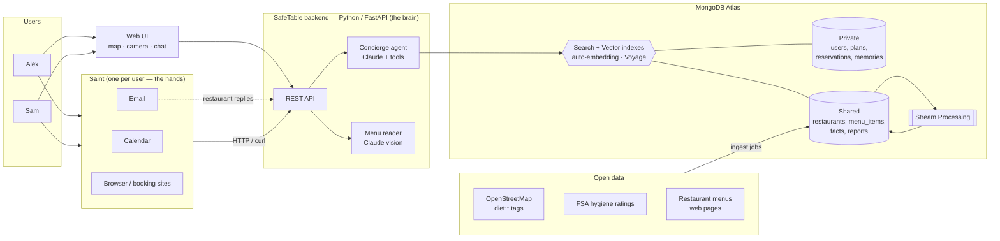
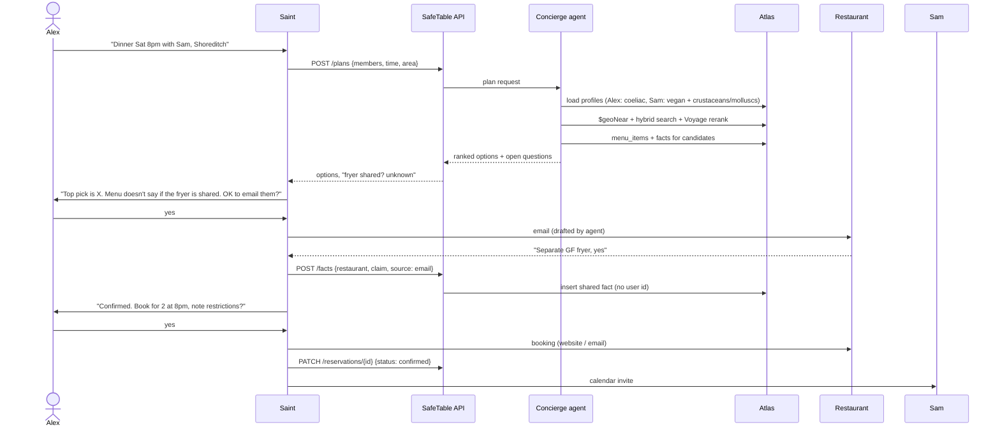
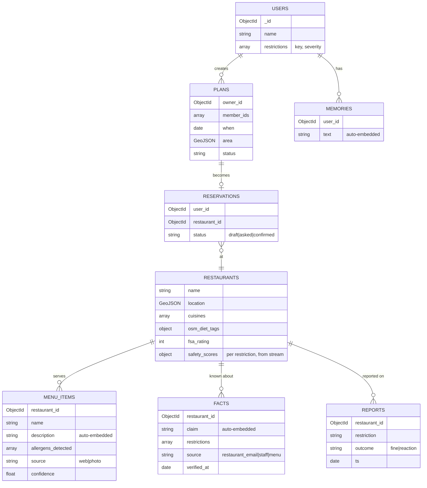

# SafeTable — Design Sketch

> Working name. A dining concierge for people with dietary restrictions (vegan, coeliac, shellfish allergy, …) that finds restaurants that work for **everyone in the group**, checks the menus, asks the restaurant what the menu doesn't say, and books the table end to end.

Status: draft, Encode 2026 hackathon. Items marked ⚠ need confirming (MongoDB workshop / Saint check-in).

---

## 1. Challenges we target

| Challenge | What judges want | How SafeTable answers it |
|---|---|---|
| **MongoDB Atlas** (main) | Atlas as the core backend; points per feature used | Search, Vector Search, Hybrid, Automated Embedding, Voyage rerank, Stream Processing (stretch) |
| **Real World** (Encode) | AI that reads the physical world; honest about uncertainty; privacy | Reads menu photos / specials boards; OpenStreetMap + FSA open data; never claims "safe" for a medical allergy without confirmation; allergy data kept private |
| **Saint** (bounty) | Saint doing a real job end to end; human control | Saint emails restaurants, books the table, sends calendar invites; asks before anything sent or booked in the user's name |

---

## 2. The demo story (3 minutes)

Two real users (us), each with real restrictions — e.g. **Alex: coeliac**, **Sam: vegan + shellfish allergy**.

1. Alex tells Saint: *"Dinner Saturday 8pm with Sam, around Shoreditch."*
2. Saint asks SafeTable for options → ranked restaurants, with how many dishes work for each person.
3. Top pick's menu doesn't say whether chips share a fryer with battered food → Saint **drafts an email to the restaurant** → **asks Alex before sending**.
4. The restaurant replies → Saint posts the answer to SafeTable → stored as a **shared, anonymous fact** about that restaurant.
5. Saint books (website/booking page or email), puts the restrictions in the booking note, sends Sam a calendar invite. **Asks before confirming.**
6. At the restaurant: Sam photographs the specials board → per-person verdict per dish (safe / avoid / ask staff).
7. Next day, Sam searches somewhere else nearby → the fryer answer Alex's Saint got is already there, *"confirmed by restaurant, 1 day ago"*. **What one user learns helps everyone.**

---

## 3. System overview



**Split of responsibilities**

- **SafeTable backend = the brain.** Knows restaurants, menus, allergens and the user's profile. Searches, checks dishes, drafts messages. Stateless: all state lives in Atlas, so one service serves every user.
- **Saint = the hands.** Acts in the real world for one user: email, calendar, browser. Calls our API to decide what to do. Single-tenant by nature.
- **Atlas = the memory.** Private data per user, plus shared knowledge that grows with every question asked.

---

## 4. End-to-end booking flow



**Where Saint stops and asks (human control)**

| Saint does on its own | Saint asks first |
|---|---|
| Search, compare, read menus | Sending any email in the user's name |
| Draft emails and bookings | Confirming a booking |
| Read restaurant replies, update SafeTable | Paying a deposit / entering card details |
| Remind the user on the day | Sharing someone's restrictions with a restaurant |

---

## 5. Restrictions model

Based on the **UK's 14 major allergens** (what UK restaurants must be able to tell you about), plus diets.

```
allergens: celery, gluten (cereals), crustaceans, eggs, fish, lupin, milk,
           molluscs, mustard, tree_nuts, peanuts, sesame, soya, sulphites
diets:     vegan, vegetarian, pescatarian, halal, kosher
"shellfish" = crustaceans + molluscs
```

Each restriction has a **severity**, which changes how careful the agent must be:

| Severity | Example | Agent behaviour |
|---|---|---|
| `preference` | vegan | Menu evidence is enough |
| `intolerance` | lactose | Flags "may contain" |
| `medical` | coeliac, anaphylaxis | **Never says "safe".** Best it says: "likely OK — confirmed by restaurant on <date>" or "ask staff". Cross-contamination counts |

**Dish verdict** (per person, per dish): `ok` · `avoid` · `ask` · `unknown`, each with `confidence` and `evidence` (the menu text or fact that justifies it).

---

## 6. Data model



**Private vs shared (multitenancy)**

- **Private** (`users`, `plans`, `reservations`, `memories`): every document has `user_id`, every query filters on it, including `$vectorSearch` (`user_id` declared as a `filter` field in the index). Allergies are health data → only stored with consent, never copied into shared collections.
- **Shared** (`restaurants`, `menu_items`, `facts`, `reports`): knowledge about places, never about people. A fact records *what* was confirmed and *how*, not *who asked*.
- Shared collections with a `user_id` field (not a database or collection per user): simplest, and keeps the number of search indexes small.

---

## 7. MongoDB features — what we use and why

| Feature | Use? | Where |
|---|---|---|
| **Atlas Search** | ✅ | `restaurants.name`, `menu_items` keywords: "gluten-free", "GF", "vegan", allergen names; fuzzy matching; facets by cuisine |
| **Vector Search** | ✅ | `menu_items.description`, `facts.claim`, `memories.text` — "a quiet place that takes coeliac seriously" |
| **Hybrid Search** | ✅ | The agent's main retrieval tool: `$rankFusion` over text + vector. Exact words matter here ("shellfish" ≠ "fish") |
| **Automated Embedding** | ✅ ⚠ | All three vector fields embedded by Atlas (Voyage under the hood) — no embedding code. Preview: confirm index syntax |
| **Voyage AI** | ✅ | `rerank-2.5` on hybrid results before the LLM; (maybe) multimodal embeddings for dish photos |
| **Stream Processing** | 🟡 stretch | `reports` + new `facts` → windowed aggregation → `restaurants.safety_scores`; alert users with an upcoming booking when a place gets bad reports |
| Geospatial (not scored) | ✅ | `2dsphere` on `restaurants.location`, `$geoNear` |

### Retrieval pipeline (sketch)

```js
// menu_items: dishes that match the query, near the area, filtered by restaurant candidates
db.menu_items.aggregate([
  { $rankFusion: {
      input: { pipelines: {
        vector: [ { $vectorSearch: {
            index: "menu_vec", path: "description",
            query: { text: "<user request>" },          // ⚠ auto-embedding query shape
            filter: { restaurant_id: { $in: candidateIds } },
            numCandidates: 200, limit: 50 } } ],
        text: [ { $search: {
            index: "menu_text",
            compound: {
              should: [ { text: { query: "<user request>", path: ["name", "description"], fuzzy: {} } } ],
              filter: [ { in: { path: "restaurant_id", value: candidateIds } } ] } } },
          { $limit: 50 } ]
      } },
      combination: { weights: { vector: 0.6, text: 0.4 } }
  } },
  { $limit: 30 }
])
// → Voyage rerank top 30 → top 8 to Claude
```

Candidates come first from `$geoNear` on `restaurants` (distance + `osm_diet_tags`), then the hybrid search runs over their dishes.

### Stream processor (stretch sketch)

```
source:  change stream on `reports` (+ `facts`)
window:  $tumblingWindow 1h, group by restaurant_id + restriction
compute: count of "reaction" vs "fine", latest confirmed facts
sink:    $merge into `restaurant_scores` → API reads it; alerts collection
```
⚠ Confirm which sources Atlas Stream Processing accepts (Atlas change streams, Kafka).

### Atlas tier
M0 (free) caps the number of search indexes, and we need ~5 (menu text, menu vector, facts vector, memories vector, restaurant text). Use the **$100 credits on an M10** for the weekend. Stream Processing instance only switched on when needed.

---

## 8. Concierge agent

Claude (Anthropic Python SDK, tool runner) with these tools:

| Tool | What it does |
|---|---|
| `get_profiles(user_ids)` | Restrictions + severities for the group (private) |
| `find_restaurants(area, when, group)` | `$geoNear` + OSM diet tags + scores |
| `search_dishes(query, restaurant_ids)` | Hybrid search + Voyage rerank |
| `get_facts(restaurant_id)` | Confirmed facts, newest first |
| `check_dish(dish, profiles)` | Per-person verdict with evidence |
| `draft_restaurant_question(restaurant_id, questions)` | Email text for Saint to send |
| `remember(user_id, text)` / `recall(user_id, query)` | Private memory (vector search filtered by `user_id`) |

Output to Saint is **structured** (JSON): ranked options, per-person dish counts, open questions, drafted messages. The agent never sends anything itself — Saint does, after asking.

**Menu reader:** photo (or menu web page) → Claude vision → list of dishes with ingredients it can see → allergen detection against the 14 → stored in `menu_items` with `source` and `confidence`. Blurry / partial photo → says so and asks for another, instead of guessing.

---

## 9. Saint-facing API (draft)

```
POST  /plans                       {owner, members, when, area}     → options + open questions
GET   /plans/{id}                                                   → current state
POST  /restaurants/{id}/questions  {questions}                      → drafted email
POST  /facts                       {restaurant_id, claim, source}   → shared fact
POST  /reports                     {restaurant_id, restriction, outcome}
PATCH /reservations/{id}           {status, details}
POST  /menu/scan                   image + user_ids                 → per-person verdicts
```
⚠ How Saint calls it (terminal/curl, browser, webhook?) — ask at Saint check-in. Plan B: a CLI wrapper `safetable <command>` that Saint runs in its terminal.

---

## 10. Data sources

| Source | What for | Notes |
|---|---|---|
| OpenStreetMap (Overpass) | Restaurants, location, `diet:vegan`, `diet:gluten_free`, cuisine | Open, London-wide |
| FSA Food Hygiene Rating API | Hygiene rating per restaurant | UK open data |
| Restaurant websites | Menus → `menu_items` | Fetch + Claude extraction, for a demo area (~30–50 places) |
| User photos | Specials boards, printed menus | Real World input |
| Saint email replies | `facts` | The shared-knowledge loop |

---

## 11. Tech stack

| Layer | Choice | Why |
|---|---|---|
| Language | Python 3.12, `uv` | Team's language |
| API | FastAPI | Fast to write, auto docs at `/docs` (handy for Saint) |
| DB driver | PyMongo (async API) | Official; Motor is deprecated |
| LLM | Claude Opus 5.5 via `anthropic` SDK | Agent tool use + vision for menus |
| Embeddings / rerank | Atlas auto-embedding + `voyageai` SDK | Counts for two MongoDB features |
| UI | ⚠ Streamlit *or* FastAPI + plain HTML/Leaflet | Streamlit = fastest for two Python devs (chat, camera, map built in); HTML = nicer on a phone |
| Agent in the world | Saint | Email, calendar, browser |
| Hosting for demo | Local + tunnel (e.g. ngrok/cloudflared) so Saint can reach the API | ⚠ |

---

## 12. Plan for the weekend

| When | Person A — data & MongoDB | Person B — agents & Saint |
|---|---|---|
| Fri evening | Atlas M10, ingest OSM + FSA for demo area | Repo, FastAPI skeleton, Claude menu reader on 3 real menus |
| Sat AM | Menus → `menu_items`; text + vector (auto-embed) indexes | Saint onboarding; agent tools stubbed |
| Sat PM | Hybrid + geo + rerank endpoint | Concierge agent end to end; Saint calls `/plans` |
| Sun AM | Stream processor (stretch); `facts`/`reports` loop | UI (map, camera, chat); email → fact loop |
| Sun PM | Seed demo data, record video | README, notes for each challenge, video |

---

## 13. Open questions

- ⚠ Automated Embedding: index + query syntax; which Voyage model.
- ⚠ Native reranking inside the pipeline vs a separate Voyage call.
- ⚠ Stream Processing sources and cost.
- ⚠ Saint: how it reaches our API; which accounts it has (email, booking sites).
- Which booking path for the demo: a real restaurant's site, or a friendly restaurant over email?
- UI: Streamlit or HTML.
- Name.
