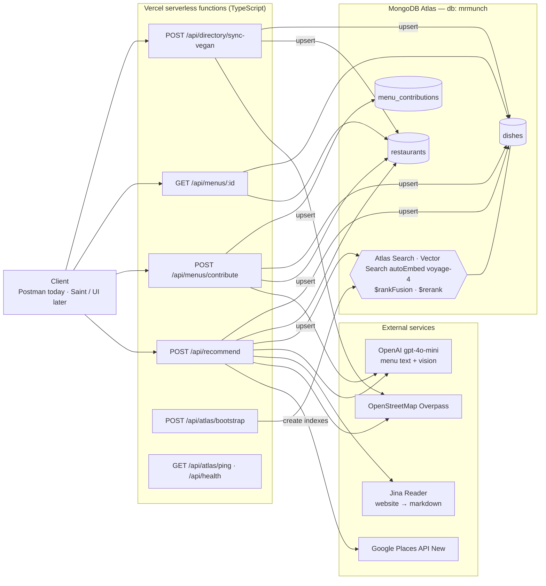
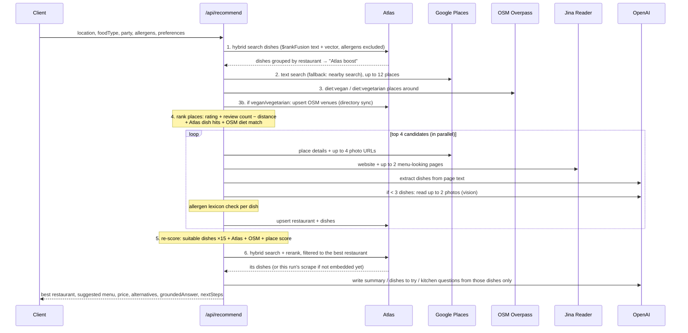

# Mr Munch — Design

> An AI dining concierge for people with dietary restrictions (vegan, coeliac, shellfish allergy, …). Give it a location, a cuisine, the party's allergens and preferences, and it finds a nearby restaurant, reads its menu, checks each dish against the UK's 14 major allergens, and hands the booking to a Saint agent, which always asks the user first.

Status: Encode 2026 hackathon, Saturday 24 Oct. This doc describes **what the code does today**, and marks what is planned but not built yet.

Legend: ✅ built and working · 🟡 partly built · ⬜ planned, not built

---

## 1. Challenges we target

| Challenge | What judges want | How Mr Munch answers it |
|---|---|---|
| **MongoDB Atlas** (main) | Atlas as the core backend; points per feature used | Atlas Search, Vector Search with Automated Embedding (Voyage), Hybrid `$rankFusion`, Voyage `$rerank`, Stream Processing recipe |
| **Real World** (Encode) | AI that reads the physical world; honest about uncertainty; privacy | Reads restaurant websites and menu / specials-board photos; OpenStreetMap open data; "unknown" never counts as "safe" |
| **Saint** (bounty) | Saint doing a real job end to end; human control | Recommend response is a hand-off for Saint to call/book; always `requiresUserConfirmation: true` |

---

## 2. Current state at a glance

| Piece | Status | Where |
|---|---|---|
| Recommend a restaurant + checked menu + price | ✅ live on Vercel | `api/recommend.ts`, `lib/recommend.ts` |
| Google Places search (text → nearby fallback) + details + photos | ✅ | `lib/services/googleMaps.ts` |
| OpenStreetMap `diet:vegan` / `diet:vegetarian` cross-check | ✅ | `lib/services/openStreetMap.ts` |
| Vegan/vegetarian directory seeded from OSM into Atlas | ✅ | `lib/services/veganDirectory.ts`, `api/directory/sync-vegan.ts` |
| Website menu scraping (Jina Reader → markdown → dishes) | ✅ | `lib/services/webReader.ts`, `lib/services/menuDiscovery.ts` |
| Menu extraction with OpenAI (text + vision) | ✅ | `lib/services/openaiVision.ts` |
| Allergen + diet check (keyword lexicon over the 14 allergens) | ✅ | `lib/allergens/lexicon.ts`, `lib/menu/parseMenu.ts` |
| User menu-photo contributions → shared dishes | ✅ | `api/menus/contribute.ts`, `lib/db/contributeMenu.ts` |
| Atlas hybrid search over dishes | ✅ (`$rankFusion` confirmed running live) | `lib/db/hybridSearch.ts` |
| Voyage rerank | 🟡 Atlas `$rerank` is unknown on our MongoDB 8.0.34 cluster; Voyage API fallback when `VOYAGE_API_KEY` is set | `lib/db/hybridSearch.ts`, `lib/services/voyage.ts` |
| Grounded answer (RAG over Atlas results) | ✅ | `lib/services/groundedAnswer.ts`, step 6 in `lib/recommend.ts` |
| Stream Processing | 🟡 pipeline JSON only, not deployed | `atlas/stream-processing/` |
| Mock mode (no keys needed) | ✅ | `lib/mock/restaurants.ts`, `lib/menu/provisional.ts` |
| No personal data stored (restrictions sent per request by Saint) | ✅ by design | `dietary_profiles` type + index are unused leftovers, can be removed |
| Restaurant answers stored as shared facts | ⬜ type + collection name exist, no endpoint | `AllergenAnswerDoc`, `allergen_answers_anonymous` |
| Saint integration (email restaurant, book, calendar) | ⬜ only the `nextSteps` hand-off in the response | — |

---

## 3. Architecture (as built)



Everything runs as stateless Vercel functions; all state lives in Atlas. One deployment serves every caller.

---

## 4. Recommend flow (`POST /api/recommend`)

Request:

```json
{
  "latitude": 51.5246, "longitude": -0.0784,
  "foodType": "vegan",
  "partySize": 2,
  "allergens": ["crustaceans", "molluscs"],
  "preferences": ["vegan", "gluten_free"],
  "dateTime": "2026-10-24T20:00:00+01:00",
  "radiusMeters": 1500
}
```



Response (shape): `restaurant` (name, location, phone, website, photos, OSM `diet` flags, `allergenConfidence`), `suggestedMenu` (up to 8 dishes with allergens and notes), `priceEstimate` (GBP per person and total), `alternatives` (up to 3), `nextSteps` (`requiresUserConfirmation: true`, `bookingChannel: "saint_agent" | "phone"`), `menuAnalysis`, `meta.sources` (a trace of every step taken).

**Fallbacks:** no Google key → mock data. Google returns nothing or errors → mock data. No menu found → a provisional menu template picked by diet, clearly marked "not verified". Atlas search indexes not ready → plain `$near` geo query. Overpass blocked → OSM venues previously stored in Atlas.

Measured on the live deployment (Shoreditch, vegan + gluten-free + no shellfish): **~47 s**, top pick Unity Diner (OSM `diet:vegan=only`, 3 m match), 4 dishes parsed, 0 marked clear → "Saint must confirm with the kitchen".

---

## 5. Menu photo contribution (`POST /api/menus/contribute`)

A user sends a menu or specials-board photo (`imageUrl` or `imageBase64`) plus the restaurant name (and ideally its Google place id).

1. Find the restaurant in Atlas by place id, then by exact name; otherwise create a stub restaurant.
2. OpenAI vision reads the photo → dishes, prices, suspected allergens.
3. The allergen lexicon re-checks each dish.
4. Dishes are upserted into `dishes` with `source: "user_contribution"`; the contribution is logged in `menu_contributions`.
5. From then on, `/api/recommend` finds those dishes through hybrid search for every user. **This is the shared-knowledge loop.**

`GET /api/menus/:restaurantId` returns the stored menu for a restaurant.

---

## 6. Allergens, diets and confidence

**Allergen ids** (UK's 14, as used in the code): `celery`, `cereals_containing_gluten`, `crustaceans`, `eggs`, `fish`, `lupin`, `milk`, `molluscs`, `mustard`, `nuts`, `peanuts`, `sesame`, `soya`, `sulphur_dioxide`.

**Preferences:** `vegan`, `vegetarian`, `pescatarian`, `halal`, `kosher`, `coeliac`, `dairy_free`, `gluten_free`, `nut_free`, `shellfish_free`.

**How a dish is checked** (`lib/allergens/lexicon.ts`): keyword matching over the dish name and description (e.g. "batter", "pasta" → gluten; "prawn" → crustaceans; "tofu", "miso" → soya), with a coconut ≠ tree-nut exception and vegan "fish cake" handling. Preferences conflict when an incompatible allergen or a meat keyword is found, unless the dish is marked vegan. When OpenAI extracts the menu, its suspected allergens are fed into the same check.

**Restaurant-level confidence** (`allergenConfidence`):

| Value | Meaning |
|---|---|
| `confirmed` | Confirmed by the restaurant (only in mock data today) |
| `menu_inferred` | ≥ 3 dishes read from the menu; inferred, not confirmed |
| `needs_restaurant_check` | Not enough menu evidence; Saint should ask |

Every inferred dish carries a note like "Inferred from website text — confirm with restaurant before booking."

---

## 7. Data model (as built)

Database `mrmunch`.

| Collection | Status | Key fields |
|---|---|---|
| `restaurants` | ✅ | `placeId` (Google id, or `osm:<id>`, or `contrib_<slug>`), `name`, `address`, `location` (GeoJSON), `phone`, `website`, `photoUrls`, `cuisine`, `rating`, `allergenConfidence`, `diet` (OSM flags), `sources` |
| `dishes` | ✅ | `restaurantPlaceId`, `restaurantName`, `name`, `description`, **`searchText`** (auto-embedded), `priceGbp`, `allergensPresent`, `suitableFor`, `location`, `cuisine`, `source` (`website_scrape` · `openai_vision` · `user_contribution` · `restaurant_confirmed`) |
| `menu_contributions` | ✅ | `contributionId`, `restaurantPlaceId`, `imageUrl`, `dishes`, `status`, `contributorAnonymousId` |
| `dietary_profiles` | ❌ not used | Leftover type + index; we decided not to store profiles (see below) |
| `allergen_answers_anonymous` | ⬜ | `restaurantPlaceId`, `question`, `answer`, `allergensConfirmed`, `anonymous: true` — shared |
| `users`, `menus`, `stream_events` | ⬜ | named in code, unused (`stream_events` is the Stream Processing sink) |

Regular indexes (created by `/api/atlas/bootstrap`): `restaurants.placeId` (unique), `restaurants.location` (2dsphere), `dishes.{restaurantPlaceId, name}` (unique), `dishes.location` (2dsphere), `dishes.allergensPresent`, `dietary_profiles.tenantId` (unique).

### Tenancy: personal data stays with Saint, knowledge is shared in Atlas

- **Each user's Saint is a single-tenant agent and keeps that user's restrictions.** It sends the allergens and preferences with every request (`allergens`, `preferences` in `/api/recommend`).
- **The API is stateless for personal data.** Mr Munch never stores who someone is or what they're allergic to. Allergies are health data, so not storing them is the simplest privacy guarantee (Real World "responsibility" criterion).
- **MongoDB Atlas holds the shared side:** `restaurants`, `dishes`, `menu_contributions`, `allergen_answers_anonymous`. Knowledge about places, never about people. Saints don't need to know about each other: what one learns (a menu photo, a restaurant's answer) lands in Atlas and helps every other user.

---

## 8. MongoDB features — status

| Feature | Status | Details |
|---|---|---|
| **Atlas Search** | ✅ | `dishes_full_text_search` (name, description, searchText, restaurantName, cuisine, allergens, geo), `restaurants_full_text_search` |
| **Vector Search** | ✅ | `dishes_vector_search` on `searchText`, filters on `allergensPresent`, `restaurantPlaceId`, `suitableFor` |
| **Automated Embedding** | ✅ | `autoEmbed` field, model `voyage-4` — Atlas embeds `searchText` itself, no embedding code |
| **Hybrid Search** | ✅ | `$rankFusion`: vector 0.55 + full-text 0.45 (fuzzy text, allergens excluded via `mustNot`, boosted by distance) |
| **Voyage AI** | ✅ / 🟡 | Embeddings via autoEmbed ✅. Rerank `rerank-2.5` 🟡: Atlas `$rerank` isn't available on MongoDB 8.0.34, so it goes through the Voyage API when `VOYAGE_API_KEY` is set |
| **RAG** | ✅ | Atlas retrieves the chosen restaurant's dishes (hybrid + rerank); the LLM writes the answer from them only, and invented dish names are dropped |
| **Stream Processing** | 🟡 | `menu_contribution_pipeline.json`: change stream on `menu_contributions` (status `parsed`) → `$emit` to time-series `stream_events`. Needs a Stream Processing instance; not deployed |
| Geospatial (not scored) | ✅ | 2dsphere + `$near` fallback, `near` scoring in `$search` |

Index definitions live in `atlas/indexes/*.json` and are created by `POST /api/atlas/bootstrap`.

---

## 9. API reference

| Method | Path | What it does |
|---|---|---|
| `GET` | `/api/health` | Status, mode (`mock`/`live`), which integrations are configured |
| `GET` | `/api/atlas/ping` | Checks Vercel → Atlas connection, returns dish count |
| `POST` | `/api/atlas/bootstrap` | Creates regular + Search/Vector indexes (optional `x-bootstrap-secret` header) |
| `POST` | `/api/recommend` | The main flow (§4) |
| `POST` | `/api/menus/contribute` | Menu photo → dishes in Atlas (§5) |
| `GET` | `/api/menus/:restaurantId` | Stored menu for a restaurant |
| `POST` | `/api/directory/sync-vegan` | `{latitude, longitude, radiusMeters?, veganOnly?}` → seed OSM vegan/vegetarian venues into Atlas |

---

## 10. Data sources

| Source | Used for | Notes |
|---|---|---|
| Google Places API (New) | Finding restaurants, details, phone, website, photos | ⚠ Google's terms allow storing **only `place_id`**; today name, address, phone, rating and photo URLs are stored in `restaurants` (and photo URLs expire) |
| OpenStreetMap Overpass | `diet:vegan` / `diet:vegetarian` flags, vegan directory | Open data, storable with attribution. Uses FR mirror first (main endpoint returns 406 from cloud IPs) |
| Restaurant websites via Jina Reader | Menus | Jina gets past many bot walls |
| OpenAI `gpt-4o-mini` | Menu extraction from text and photos | Configurable via `OPENAI_VISION_MODEL` |
| User photos | Specials boards, printed menus | Real World input |
| HappyCow | Not used | Bot-protected and its ToS forbids scraping; OSM is the legal substitute |

---

## 11. Tech stack

| Layer | Choice |
|---|---|
| Language | TypeScript (Node ≥ 20, ESM) |
| Hosting | Vercel serverless functions (`maxDuration` 60 s on the slow routes) |
| Validation | Zod |
| Database | MongoDB Atlas, official `mongodb` driver v6 |
| Embeddings / rerank | Inside Atlas (autoEmbed `voyage-4`, `$rerank` `rerank-2.5`) |
| LLM | OpenAI `gpt-4o-mini` (raw `fetch`, JSON mode) |
| Places / open data | Google Places API (New), OSM Overpass, Jina Reader |
| Agent in the world | Saint (not integrated yet) |

---

## 12. How to test

### Against the live deployment (fastest)

```bash
BASE=https://mrmunch.vercel.app

curl $BASE/api/health          # mode + integrations
curl $BASE/api/atlas/ping      # Atlas reachable + dish count

curl -X POST $BASE/api/recommend -H 'Content-Type: application/json' -d '{
  "latitude": 51.5246, "longitude": -0.0784, "foodType": "vegan", "partySize": 2,
  "allergens": ["crustaceans","molluscs"], "preferences": ["vegan","gluten_free"],
  "dateTime": "2026-10-24T20:00:00+01:00", "radiusMeters": 1500 }'
```

Expect ~45 s. Each live call spends Google and OpenAI credit and writes to the shared Atlas database. Or import `postman/MrMunch.postman_collection.json` and set `baseUrl` to the deployment.

### Locally

```bash
npm install
npm run typecheck
cp .env.example .env      # leave keys empty for mock mode
npm run dev               # vercel dev → http://localhost:3000 (needs `vercel login` once)
```

- **Mock mode:** no keys → `/api/recommend` returns mock London venues; good for UI work.
- **Live mode:** set `GOOGLE_MAPS_API_KEY` (live mode switches on automatically), plus `MONGODB_URI`, `MONGODB_DB=mrmunch`, `OPENAI_API_KEY`. Run `POST /api/atlas/bootstrap` once and wait for the indexes to be *Ready* in Atlas.
- **Rerank:** set `VOYAGE_API_KEY`; `meta.sources` should show `atlas:hybrid_rankFusion_voyage_api_rerank` (or `…_voyage_rerank` on a cluster that supports `$rerank`). Plain `atlas:hybrid_rankFusion` means no rerank ran.
- **Grounded answer:** check `groundedAnswer` in the response and `grounded_answer:atlas:…` in `meta.sources`.
- **Shared-knowledge loop:** contribute a menu photo for a restaurant, then `GET /api/menus/:restaurantId`, then call `/api/recommend` near it and look for `Atlas knew N dishes` in `nextSteps.message`.

---

## 13. Saint hand-off

`/api/recommend` returns `nextSteps` with `requiresUserConfirmation: true` and `bookingChannel` (`saint_agent` when a phone number is known, otherwise `phone`).

**Where Saint stops and asks:** sending any email or message in the user's name, confirming a booking, paying a deposit, sharing someone's restrictions with a restaurant.
